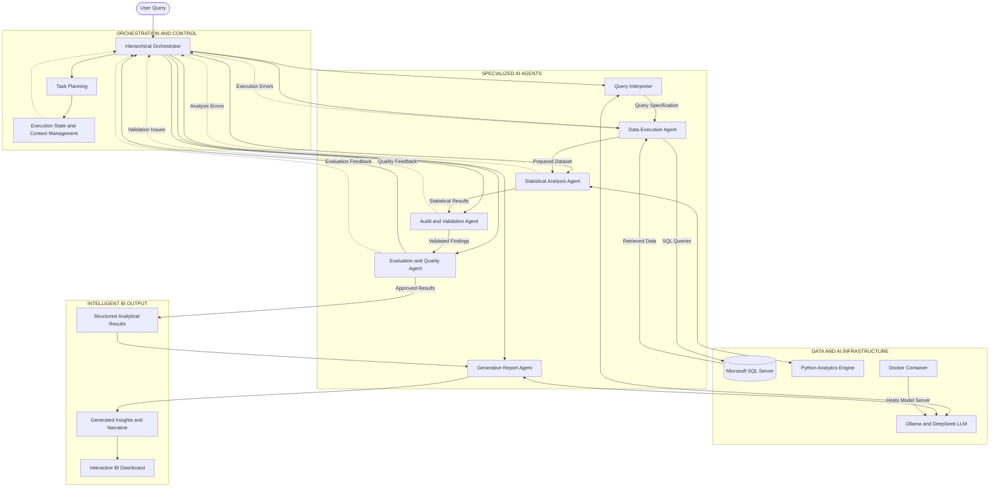

# ◈ DataLens AI

### Generative Business Intelligence · Hierarchical Multi-Agent Systems

**From Enterprise Data to Intelligent Decisions.**

Plataforma de Business Intelligence impulsada por IA generativa que transforma consultas en lenguaje natural en análisis estadísticos, insights empresariales y reportes interactivos.

### Technology Stack

**Frontend & Backend**


**Data Engineering & Analytics**


**Artificial Intelligence & LLMs**


**Infrastructure & Containerization**


**Business Intelligence & Visualization**


---

### Technology Architecture

| Área | Tecnologías |
|---|---|
| Frontend | React, TypeScript, Tailwind CSS |
| Backend | Node.js, Firebase Cloud Functions |
| Data Engineering | Python, Pandas, NumPy |
| Data Sources | Microsoft SQL Server, Excel, CSV |
| Database | Microsoft SQL Server |
| AI Infrastructure | Ollama, LLMs |
| Reasoning Models | DeepSeek-R1-Distill-Qwen-7B |
| Containerization | Docker, Docker Compose |
| GPU Acceleration | NVIDIA CUDA |
| Model Serving | Python API, REST APIs, Ollama |
| Business Intelligence | Power BI, Interactive BI |
| Data Visualization | Chart.js, Dynamic Reports |
| Communication | REST APIs, JSON |
| Analytics | Statistical Analysis, Data Validation |

---

## ✦ ¿Qué es DataLens AI?

DataLens AI es una plataforma de **Intelligent Analytics** que combina ingeniería de datos, modelos de lenguaje (LLMs), razonamiento especializado y sistemas multiagente para automatizar procesos de análisis empresarial.

Su propuesta es sencilla: permitir que cualquier usuario consulte información empresarial mediante lenguaje natural y obtenga resultados estructurados, respaldados por operaciones estadísticas y presentados mediante reportes dinámicos.

**No se trata solamente de consultar datos con IA, sino de construir un sistema capaz de interpretar, planificar, analizar, verificar y comunicar resultados.**

## ◈ Arquitectura inteligente

El núcleo de DataLens AI utiliza una arquitectura de **orquestación jerárquica multiagente**, donde cada agente tiene responsabilidades especializadas y trabaja bajo la coordinación de un supervisor central.



### Agentes especializados

| Agente | Responsabilidad |
|---|---|
| **Orchestrator** | Coordina tareas, agentes y flujo de ejecución. |
| **Query Interpreter** | Convierte lenguaje natural en instrucciones analíticas estructuradas (JSON). |
| **Execution Agent** | Gestiona consultas, servicios y recuperación de datos. |
| **Statistical Analyst** | Determina y ejecuta procedimientos estadísticos. |
| **Audit Agent** | Verifica coherencia, integridad y consistencia de resultados. |
| **Evaluation Agent** | Evalúa precisión y calidad mediante criterios de validación. |
| **Report Generator** | Convierte resultados en reportes e insights visuales. |

## ⚡ Pipeline de inteligencia

```text
01  DATA INGESTION
    SQL Server · CSV · Excel
              ↓
02  QUERY INTERPRETATION
    Natural Language → Structured JSON
              ↓
03  HIERARCHICAL ORCHESTRATION
    Task Planning · Agent Coordination
              ↓
04  DATA PROCESSING & ANALYTICS
    Python · Statistical Analysis
              ↓
05  AUDIT & EVALUATION
    Consistency · Accuracy · Validation
              ↓
06  GENERATIVE REPORTING
    LLMs · Insights · Interactive BI
```

## ◈ Inteligencia artificial

La arquitectura contempla una estrategia multimodelo, distribuyendo las responsabilidades de acuerdo con la naturaleza de cada tarea.

- **Ollama:** infraestructura de ejecución y administración de modelos LLM.
- **DeepSeek-R1-Distill-Qwen-7B:** modelo utilizado para experimentación con razonamiento especializado.
- **Docker:** containerización del entorno de ejecución del modelo y sus servicios asociados.
- **Docker Compose:** configuración y administración de los servicios mediante una definición centralizada.
- **LLM Orchestration:** interpretación, planificación y coordinación de agentes.
- **Generative AI:** generación de explicaciones, síntesis y narrativas analíticas.

Los cálculos estadísticos se delegan a herramientas deterministas, evitando depender exclusivamente de los modelos generativos para obtener resultados numéricos.

## ◈ Infrastructure & Deployment

DataLens AI incorpora una infraestructura basada en contenedores para facilitar la ejecución y administración de sus componentes de inteligencia artificial.

**Docker & Containerization**

- **Docker Engine:** ejecución de servicios y entornos aislados mediante contenedores.
- **Docker Compose:** definición, configuración y administración de servicios.
- **Containerized LLM Server:** ejecución del servidor de inferencia de DeepSeek en un entorno Docker.
- **NVIDIA CUDA:** soporte para aceleración por GPU en entornos compatibles.
- **REST API:** comunicación entre el backend de la aplicación y el servidor de modelos.

Esta implementación permite mantener el servidor de inferencia independiente del frontend y de los servicios de orquestación, reduciendo la dependencia de ejecuciones manuales y facilitando la continuidad del entorno de desarrollo.

## ◈ Data Engineering & Business Intelligence

La solución contempla integración con fuentes de datos empresariales, particularmente Microsoft SQL Server, mediante una arquitectura que separa el acceso a datos de la lógica de inteligencia artificial.

**Capacidades analíticas contempladas:**

- Estadística descriptiva y análisis comparativo.
- Identificación de tendencias y anomalías.
- Evaluación de KPIs y variaciones porcentuales.
- Análisis de correlaciones y distribuciones.
- Generación de resúmenes ejecutivos.
- Visualizaciones y reportes interactivos.

## ◈ Experiencia de usuario

Una interfaz de análisis conversacional inspirada en el enfoque de Generative UI.

- **Conversational Analytics:** consultas empresariales en lenguaje natural.
- **Agent Step Tracker:** seguimiento del flujo de ejecución.
- **Interactive Reports:** métricas, tablas y visualizaciones.
- **Query Refinement:** refinamiento contextual de consultas.
- **Dynamic Reporting:** presentación estructurada de resultados.

---
